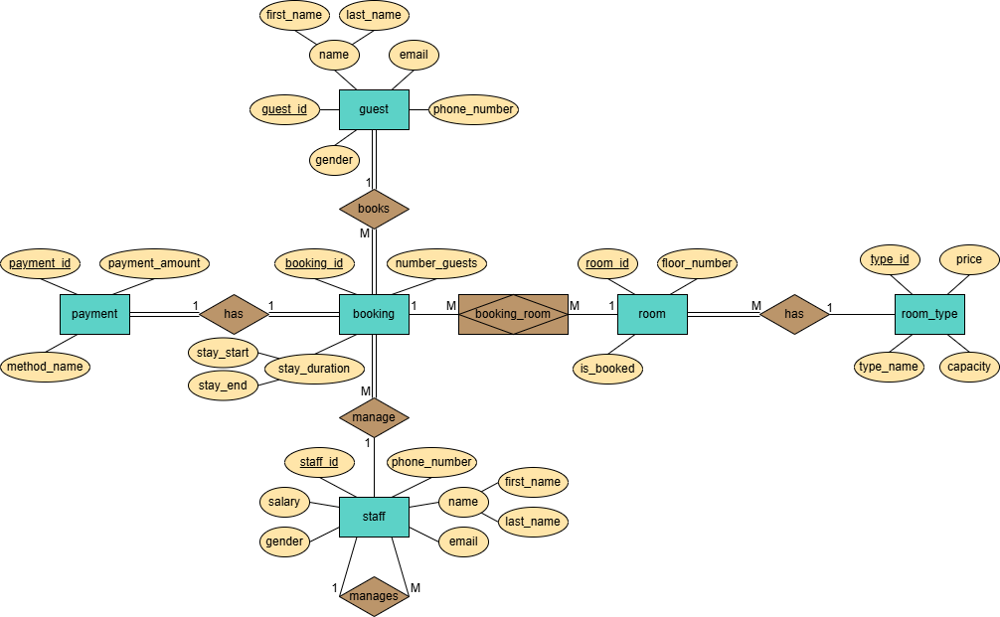
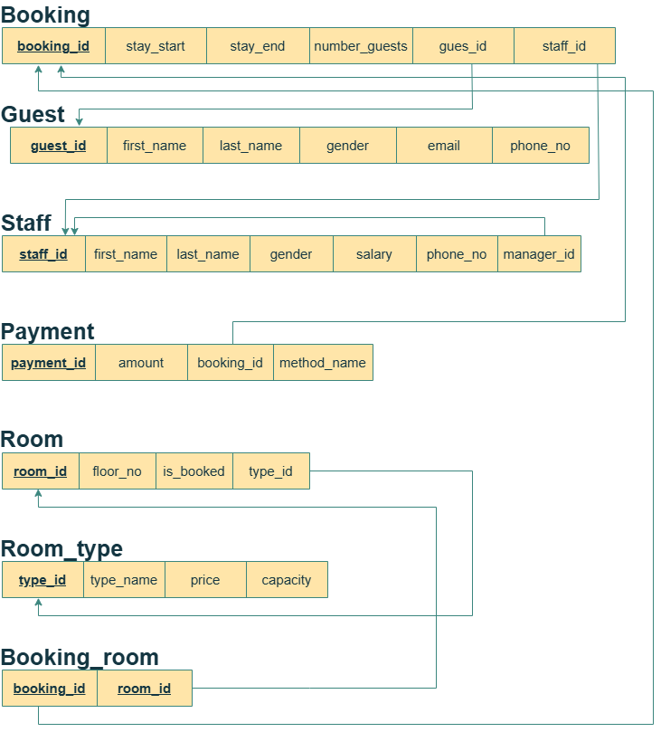
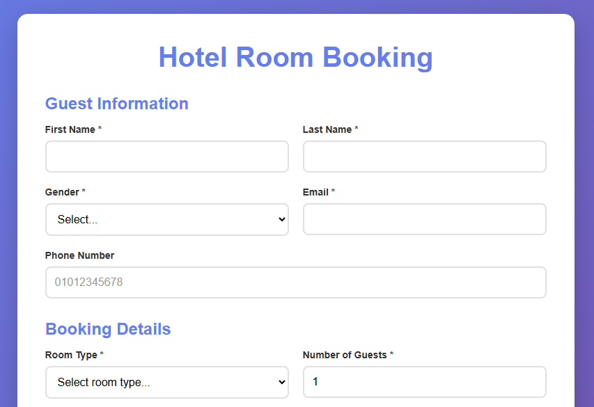

# Hotel Booking System Database

A complete relational database system designed for hotel booking management. This project covers the full database development lifecycle: requirements analysis, ER diagram design, relational schema mapping, SQL DDL/DML implementation, 10 analytical queries, and a PHP/MySQL web interface for real-time room reservations.

## Demo

*Entity Relationship Diagram (ERD)*



*Relational Schema*



*Booking Form Web Interface*




## Features

- **Normalized Relational Schema:** Properly normalized tables (up to 3NF) with primary keys, foreign keys, and integrity constraints.
- **Complete SQL Implementation:** DDL statements for table creation, DML statements for sample data, and 10+ analytical queries covering joins, aggregations, subqueries, and views.
- **Automated Triggers:** Database triggers prevent double-booking and automatically update room availability status.
- **Web Interface (PHP/MySQL):** A user-friendly booking form with real-time price calculation, date validation, and guest capacity checks.
- **Financial Reporting View:** A pre-built SQL view (`v_financial_booking_status`) for quick financial analysis and reporting.

## Tech Stack

- **Database:** MySQL / MariaDB
- **Language (Backend):** PHP 8+
- **Language (Frontend):** HTML, CSS, JavaScript
- **Tools:** phpMyAdmin, MySQL Workbench (optional)

## Getting Started

### Prerequisites

- XAMPP, WAMP, or MAMP installed (for Apache + MySQL + PHP).
- A web browser.
- phpMyAdmin (comes with XAMPP).

### Installation

1. Clone the repository:

   ```bash
   git clone https://github.com/YourUsername/hotel-booking-system-database.git
   ```

2. **Import the Database:**
   - Open phpMyAdmin (`http://localhost/phpmyadmin`).
   - Create a new database named `hotel_system`.
   - Click **Import** and upload `hotel_booking_system.sql`.
   - Click **Go** to execute the script.

> The DDL and DML statements used in `hotel_booking_system.sql` are also documented in [sql_implementation_report.pdf](sql_implementation_report.pdf).

3. **Set Up the Web Interface:**
   - Copy the `booking.php`, `script.js`, and `style.css` files into your web server's root directory (e.g., `C:\xampp\htdocs\hotel_booking`).
   - Update the database connection settings in `booking.php` if needed:

     ```php
     $host = 'localhost:3307';  // Adjust port if needed
     $user = 'root';
     $pass = '';
     $db = 'hotel_system';
     ```

4. **Run the Application:**
   - Open your browser and navigate to `http://localhost/hotel_booking/booking.php`.
   - Fill in the form and click **Book Now** to test the system.

## How It Works

### Database Schema Overview

The database consists of **7 tables**:

| Table | Description |
|-------|-------------|
| `Guest` | Stores guest personal information (name, email, phone, gender). |
| `Booking` | Records each booking (guest, staff, dates, number of guests). |
| `Staff` | Stores staff details, including manager relationships (self-referencing FK). |
| `Payment` | One-to-one relationship with Booking (each booking has one payment). |
| `Room` | Stores room details (floor, type, availability status). |
| `Room_Type` | Defines room categories (Single, Double, Suite, Family) with price and capacity. |
| `Booking_Room` | Junction table resolving the many-to-many relationship between Booking and Room. |

### Key Relationships

- A **Guest** can make many **Bookings** (1:M).
- A **Booking** has exactly one **Payment** (1:1).
- A **Staff** member manages many **Bookings** (1:M).
- A **Staff** member may have a **Manager** (self-referencing 1:M).
- A **Booking** can include many **Rooms**, and a **Room** can be booked many times (M:N via `Booking_Room`).
- A **Room** must have one **Room_Type**, and a **Room_Type** can have many **Rooms** (1:M).

> For a full breakdown of all tables, columns, constraints, and examples, see [data_dictionary.md](data_dictionary.md).

### Sample SQL Queries Included

1. Retrieve payments and booking details (INNER JOIN).
2. Retrieve all bookings of guests, even if they have none (LEFT JOIN).
3. Retrieve all room types and their booking status (RIGHT JOIN).
4. Calculate total salaries and averages by gender (GROUP BY + aggregates).
5. Retrieve employees and their managers (self-join).
6. Retrieve full booking details across 5 tables (multi-table INNER JOIN).
7. Retrieve available double rooms (WHERE filter + JOIN).
8. Calculate stay duration for each guest (DATEDIFF).
9. Retrieve staff with a high number of bookings (GROUP BY + HAVING).
10. Create and query a financial reporting view (CREATE VIEW).

> The output of each query and a step-by-step explanation of how it executes are in [sql_implementation_report.pdf](sql_implementation_report.pdf).

### Triggers

Three triggers are implemented for data integrity:

- **`prevent_double_booking`:** Blocks a reservation if the room is already booked.
- **`set_room_booked`:** Automatically sets `is_booked = 1` when a room is added to a booking.
- **`set_room_unbooked`:** Automatically sets `is_booked = 0` when a booking is cancelled/deleted.

## Known Limitations

- **Hardcoded DB Credentials:** The database credentials in `booking.php` are hardcoded for local development. For production, they should be moved to environment variables or a configuration file.
- **No User Authentication:** The web interface does not include login or authentication. Any user can make a booking.
- **Basic UI:** The web form is functional but minimal. A production system would require more robust error handling, input sanitization, and user feedback.
- **No Cancellation Feature:** The web interface only supports creating bookings, not viewing or cancelling them.
