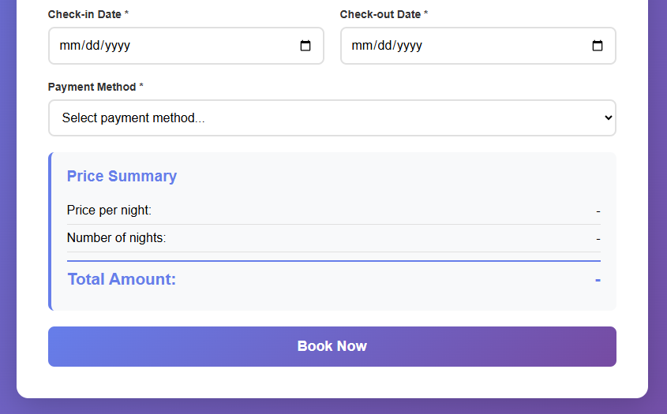

# Hotel Booking System Database

A complete relational database system designed for hotel booking management. This project covers the full database development lifecycle: requirements analysis, ER diagram design, relational schema mapping, SQL DDL/DML implementation, 10+ analytical queries, and a PHP/MySQL web interface for real-time room reservations.

## Demo

*Entity Relationship Diagram (ERD)*


*Relational Schema*


*Booking Form Web Interface*



## Features

- **Normalized Relational Schema:** Properly normalized tables (up to 3NF) with primary keys, foreign keys, and integrity constraints.
- **Complete SQL Implementation:** DDL statements for table creation, DML statements for sample data, and 10+ analytical queries covering joins, aggregations, subqueries, and views.
- **Automated Triggers:** Database triggers prevent double-booking and automatically update room availability status.
- **Web Interface (PHP/MySQL):** A user-friendly booking form with real-time price calculation, date validation, and guest capacity checks.
- **Financial Reporting View:** A pre-built SQL view (`v_financial_booking_status`) for quick financial analysis and reporting.

## Tech Stack

- **Database:** MySQL / MariaDB
- **Language (Backend):** PHP 8+
- **Language (Frontend):** HTML, CSS, JavaScript
- **Tools:** phpMyAdmin, MySQL Workbench (optional)

## Getting Started

### Prerequisites
- XAMPP, WAMP, or MAMP installed (for Apache + MySQL + PHP).
- A web browser.
- phpMyAdmin (comes with XAMPP).

### Installation

Clone the repository:
   ```bash
   git clone https://github.com/YourUsername/hotel-booking-system-database.git
